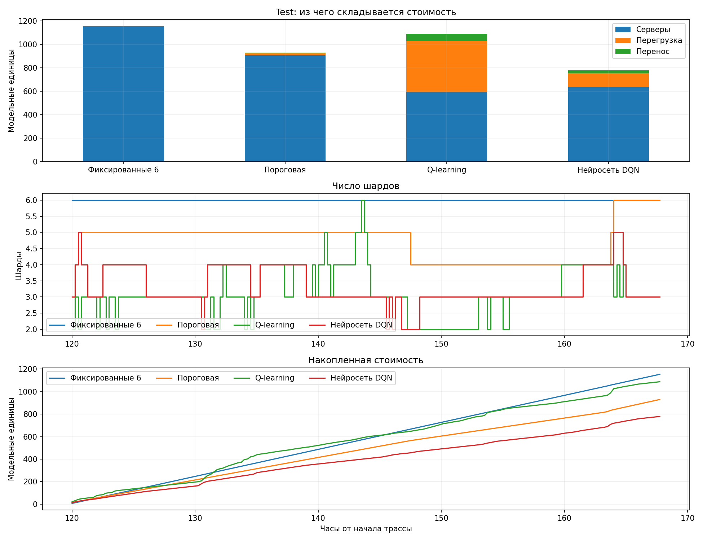

# Шардинг и обучение с подкреплением на трассах Twitter

Учебный проект: реальные запросы к кешу → Jump Consistent Hash → симулятор → простые стратегии → Q-learning → нейросеть Double DQN → дообучение с приоритетом на снижение перегрузки.

**Данные:** 9 695 769 запросов, 44 744 ключа, первые 168 часов открытой выборки Twitter cluster7 sample100. Это запросы get/set к кешу, не тексты твитов. Разбиение: 96 часов train / 24 validation / 48 test. Управление каждые 15 минут, 2–8 шардов.

## Результаты

| Стратегия | Стоимость в модели | Интервалов с перегрузкой из 192 |
|---|---:|---:|
| Пороговая | 929.84 | 4 |
| Табличный Q-learning | 1087.38 | 74 |
| Исходная DQN | 779.10 | 46 |
| Дообученная DQN | 889.65 | 2 |

Исходная DQN дешевле пороговой стратегии на 16.2%, но чаще допускает перегрузку. Дообучение снижает её частоту до двух первых интервалов разгона. Идеальный алгоритм со знанием будущего при том же старте с двух шардов и лимите +1 шард за шаг также имеет минимум 2 перегруженных интервала. Это не означает глобальной оптимальности нейросети по стоимости.

Последний эксперимент оценивается на уже известном тестовом периоде: это повторная диагностическая оценка, не независимое подтверждение. Мощность серверов и цены модельные; реальный ClickHouse не измерялся.



## Что смотреть преподавателю

- [Карта проверяемых результатов](docs/ASSESSMENT.md)
- [Роль автора и использование ИИ](CONTRIBUTIONS.md)
- [Результаты исходного эксперимента](RESULTS.md)
- [Результаты дообучения](SAFETY_RESULTS.md)
- [Подробная методология](docs/METHODOLOGY.md)
- [История этапов](CHANGELOG.md)

## Ноутбуки по порядку

1. [Обзор данных](01_data_overview.ipynb)
2. [Симулятор и baselines](02_simulation_and_baselines.ipynb)
3. [Q-learning](03_q_learning.ipynb)
4. [Нейросеть и подбор гиперпараметров](04_neural_dqn.ipynb)
5. [Сравнение](05_comparison.ipynb)
6. [Дообучение для снижения перегрузки](06_safety_finetuning.ipynb)

Ноутбуки выполнены; таблицы, графики, протоколы, истории обучения и веса сохранены в results/. В 03/04 по умолчанию загружаются готовые модели. Для нового обучения используйте новый каталог результатов; не подбирайте параметры по уже просмотренному test.

## Запуск

```sh
python3 -m venv .venv
source .venv/bin/activate
python -m pip install -r requirements.txt
python -m unittest discover -s tests -v
python -m jupyter lab
```

Для точного окружения исходного запуска на Mac/Python 3.9 есть requirements-lock.txt. Сжатый исходник (~49 МБ) не хранится в Git; производные агрегаты включены, поэтому тесты и оценка сохранённых моделей работают без скачивания. Для полного восстановления данных нужен zstd:

```sh
python download_data.py
python data_pipeline.py
```

Обучение исходных моделей: `python experiments.py`. Дообучение: `python safe_finetuning.py`. Эти команды запускают поиск параметров и могут перезаписать одноимённые результаты; для нового исследования используйте отдельную копию/ветку и новый период данных.

## Источники и права

[Twitter cache-trace](https://github.com/twitter/cache-trace), [файл CMU](https://ftp.pdl.cmu.edu/pub/datasets/twemcacheWorkload/open_source/sample100/cluster7.sort.sample100.zst). Juncheng Yang, Yao Yue, Rashmi Vinayak, *A large scale analysis of hundreds of in-memory cache clusters at Twitter*, OSDI 2020. Данные и документация источника — CC BY 4.0. Метод sample100 не подтверждён: показатели не пересчитываются на полный кластер.

Лицензия исходного датасета не является автоматически лицензией нового кода проекта. Отдельная лицензия кода пока не выбрана.
